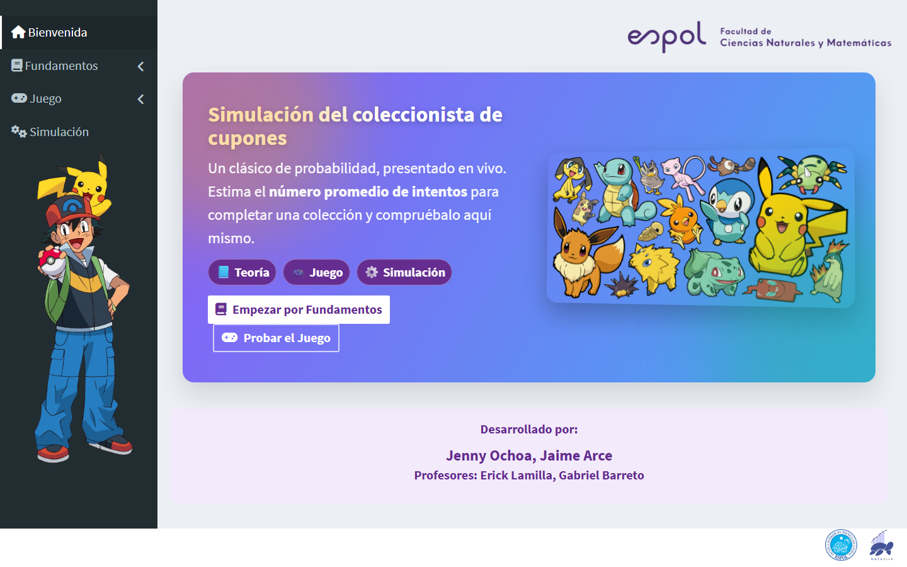
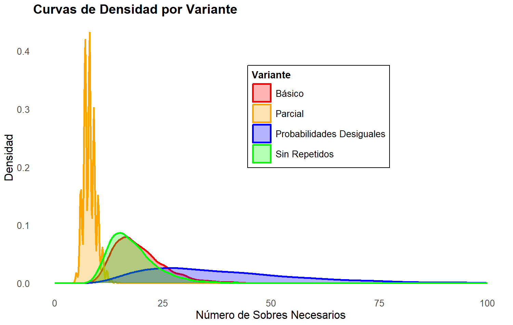

# Simulación del coleccionista de cupones

App interactiva en R Shiny que responde una pregunta de probabilidad clásica: ¿cuántos sobres hay que abrir, en promedio, para completar una colección? El visitante juega a llenar su colección, simula miles de colecciones con el método Monte Carlo y compara su resultado con la fórmula teórica.

Proyecto ganador del área de Estadística en la Feria de Ciencias ESPOL 2025.



## Qué hace la app

| Sección | Contenido |
| --- | --- |
| Fundamentos | Contexto del problema, teoría, aplicaciones reales (álbumes, genómica, computación), variantes y el método Monte Carlo |
| Juego | El visitante abre sobres hasta completar 4 cupones; sus intentos se guardan en una tabla de jugadores |
| Simulación | El usuario elige el tamaño de la colección, los cupones por sobre y el número de simulaciones, y ve la distribución de sobres necesarios frente al valor teórico |

## La matemática

Con n cupones distintos y un cupón por sobre, el número esperado de sobres es

E[X] = n · H(n),  con  H(n) = 1 + 1/2 + 1/3 + … + 1/n

Cada cupón nuevo se consigue con una distribución geométrica cuya probabilidad de éxito baja a medida que la colección se completa: por eso los últimos cupones cuestan tanto.

## Resultados de la simulación

Con 25 cupones, 5 cupones por sobre y 10 000 simulaciones:

| Variante | Sobres en promedio |
| --- | --- |
| Básico (todos los cupones igual de probables) | 19,5 (aproximación teórica: 19,1) |
| Sin cupones repetidos dentro del sobre | 17,9 |
| Meta parcial (completar el 80 % de la colección) | 8,1 |
| Probabilidades desiguales (5 cupones raros) | 39,7 |

Completar el último 20 % de la colección cuesta más que el primer 80 %, y que haya unos pocos cupones raros duplica el número de sobres necesarios.



## Cómo ejecutarla

Necesitas R (probada con R 4.4.2) y estos paquetes:

```r
install.packages(c("shiny", "ggplot2", "dplyr", "bslib",
                   "shinyWidgets", "shinydashboard", "shinyjs"))
shiny::runApp()
```

## Estructura

```
app.R            la aplicación Shiny
www/             imágenes que usa la app
simulaciones/    scripts de R con la simulación Monte Carlo y las variantes
docs/            propuesta del proyecto
capturas/        imágenes de este README
```

## Autoría

Desarrollado por Jenny Ochoa y Jaime Arce, con la guía de los profesores Erick Lamilla y Gabriel Barreto, para el D.A.T.A. Club y la Facultad de Ciencias Naturales y Matemáticas de ESPOL.
